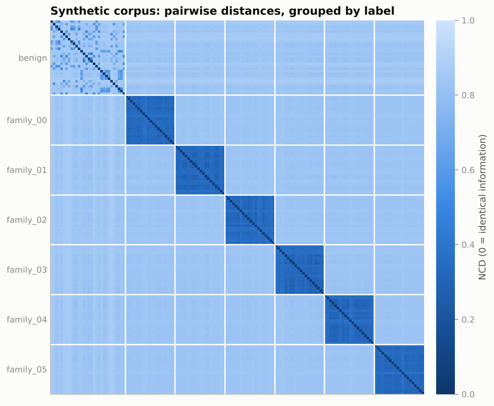
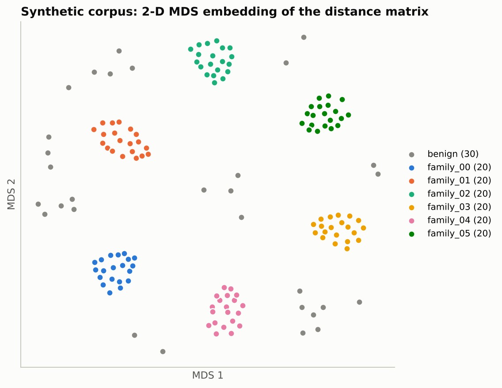
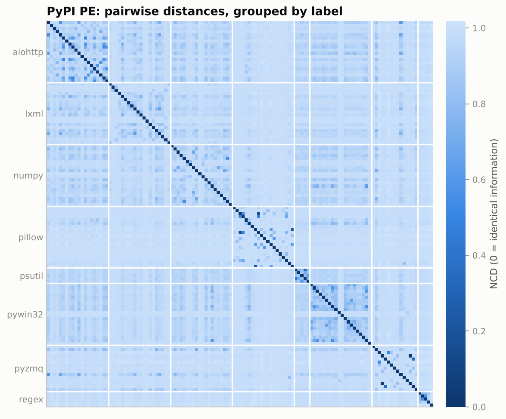
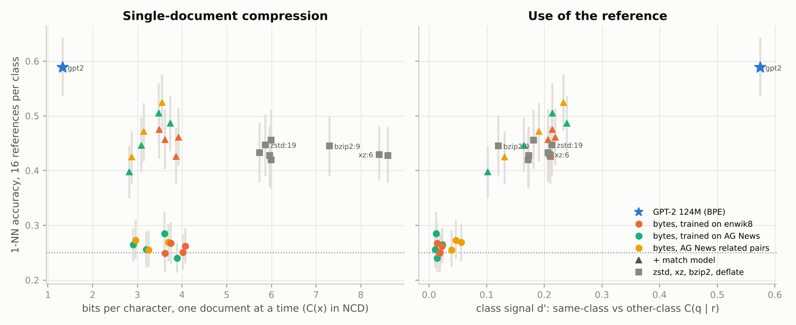

# NCD

Normalized Compression Distance (NCD) for malware family classification and network anomaly detection. The core is written in Rust and evaluated against classical machine learning baselines on the same samples.

## Background

`K(x)` is the length of the shortest program that outputs `x`. The normalized information distance

```
NID(x, y) = max{K(x|y), K(y|x)} / max{K(x), K(y)}
```

is uncomputable. Replacing `K` with a real compressor `C` gives the NCD (Cilibrasi and Vitányi, 2005):

```
NCD(x, y) = (C(xy) - min{C(x), C(y)}) / max{C(x), C(y)}
```

It needs no hand-made features or format-specific parsers. Real compressors also break the metric axioms, have finite windows and add a fixed cost per object. This project measures those effects.

Theory and design principles (Spanish): [docs/FUNDAMENTOS.md](docs/FUNDAMENTOS.md).

## Components

- `ncd-core`: zstd, xz, bzip2 and DEFLATE codecs; parallel pairwise and cross matrices; two estimators (`concat` uses `C(xy)`, `conditional` compresses the larger object using the smaller one as a zstd dictionary); window overflow warnings; bounds-checked PE/ELF code section extraction; k-NN, anomaly scores and metrics.
- `ncd`: command line interface with `dist`, `matrix`, `eval`, `score`, `bench` and `synth`.
- `ncdthreat`: Python bindings via PyO3. Bytes are borrowed without copying and the GIL is released during compression.
- `python/`: sample fetchers (MalwareBazaar, PyPI), EMBER v3 features, random, temporal or per-file splits, EMBER and flow baselines (GBDT, k-NN, Isolation Forest), CICFlowMeter windowing, NCD evaluation and plots.
- `python/lmcodec`: arithmetic coder, transformer with key/value cache, GPT-2 tokenizer, Hugging Face adapter (`lm:hf:ORG/MODEL`), match model and NCD estimators for language-model codecs (needs `python/requirements-lm.txt`).
- `scripts/`: setup, text-data download, and end-to-end runs for the text experiment, PE families (MalwareBazaar or a PyPI dry run, with an evasion test) and CIC-IDS2017 (including a language model trained on benign traffic).
- `flake.nix` and CI: build, tests, clippy, an end-to-end smoke test and `nix flake check`.

## Usage

Step-by-step runbook (Spanish) for setup, data downloads, training and every experiment: [docs/PASOS.md](docs/PASOS.md). The scripts in `scripts/` resume where they stopped:

```bash
./scripts/setup.sh                                   # build, venv, bindings, tests
./scripts/download_text_data.sh && ./scripts/text_experiment.sh
SOURCE=pypi ./scripts/malware_families.sh            # or SOURCE=bazaar with ABUSECH_AUTH_KEY, in a VM
CSV_DIR=~/ncd-data/cic/TrafficLabelling ./scripts/cic_ids2017.sh
```

```bash
nix develop            # or rustup plus python/requirements.txt
cargo build --release
cargo test --release
maturin develop --release -m crates/ncd-py/Cargo.toml
./scripts/demo.sh      # synthetic benchmark and figures
```

```bash
ncd dist a.exe b.exe -c zstd:19 -m conditional -v code
ncd eval corpus/ -k 1 --split-file splits.csv --json results/malware_ncd.json
ncd score --refs benign_train/ --queries test/ -k 5 -o scores.csv
ncd bench corpus/ --codecs zstd:3,zstd:19,xz:9,bzip2:9,deflate:9
```

```python
import ncdthreat as nt
D = nt.pairwise(objs, codec="zstd:19", method="conditional")
s = nt.anomaly_scores(queries, benign_refs, k=5)
```

A corpus is a directory `ROOT/<label>/<sample>`. The file stem, usually the SHA-256, is the sample id.

## Synthetic results

150 synthetic samples (6 families of 20 plus 30 benign, 22 KB on average), 11,175 pairs, 2 cores. Every codec reaches 1.0 leave-one-out accuracy, so the corpus only checks the pipeline. The differences are in cost and diagnostics.

| codec | estimator | NCD(x,x) | pairs over window | matrix time |
|---|---|---:|---:|---:|
| zstd:3 | concat | 0.0008 | 0 | 1.3 s |
| zstd:19 | concat | 0.0009 | 0 | 58.8 s |
| zstd:19 | conditional | 0.0019 | 0 | 17.2 s |
| xz:9 | concat | 0.0063 | 0 | 57.1 s |
| bzip2:9 | concat | 0.2697 | 0 | 32.9 s |
| deflate:9 | concat | 0.0456 | 11,175 | 11.5 s |

<p align="center">
  
  
</p>

Observations:

- `conditional` is 3.4x faster than `concat` at zstd:19 with the same accuracy, because each dictionary is built once per row.
- DEFLATE has a 32 KiB window. Above it `C(xy) ≈ C(x) + C(y)` and NCD saturates near 1, even for identical objects.
- bzip2 gives `NCD(x, x) ≈ 0.27` on incompressible data, so it fails the identity axiom.
- xz presets 7 to 9 allocated a 16 to 64 MiB dictionary per call. Limiting it to the input size gives identical output and cut an 80-sample matrix from 366 s to 11 s.
- The CLI and the Python bindings produce the same anomaly AUC to four decimals.

On generated CICFlowMeter traffic (`python/ablation_window.py`, zstd:19, k = 5), window size matters more than the estimator:

| flows/window | bytes | k-NN F1 concat | k-NN F1 conditional | AUC concat | AUC conditional |
|---:|---:|---:|---:|---:|---:|
| 16 | 176 | 0.106 | 0.705 | 0.764 | 0.776 |
| 32 | 348 | 0.921 | 0.856 | 0.839 | 0.729 |
| 64 | 699 | 1.000 | 0.797 | 0.934 | 0.925 |
| 128 | 1,399 | 1.000 | 0.732 | 0.990 | 1.000 |

The defaults are 64-flow windows with `concat` for traffic and `conditional` for binaries. Baselines on aggregate flow statistics score about 1.0 on this generated traffic, so a real comparison needs real captures.

## Real data

Step-by-step guide (Spanish): [docs/DATOS_REALES.md](docs/DATOS_REALES.md). Sources:

- Binaries: MalwareBazaar (`python/fetch_bazaar.py`, needs an abuse.ch Auth-Key), BODMAS (binaries on request), or benign PyPI Windows wheels for a dry run (`python/fetch_pypi_pe.py`).
- Baseline features: EMBER v3 via thrember (`python/ember_features.py`).
- Traffic: CIC-IDS2017 `GeneratedLabelledFlows` (TrafficLabelling CSVs keep Source IP and Timestamp), LYCOS-IDS2017 or CSE-CIC-IDS2018.

```bash
python python/fetch_pypi_pe.py --out data/pypi
python python/make_split.py --meta data/pypi/metadata.csv --id-col sha256 --label-col family \
    --time-col first_seen --protocol temporal --min-per-family 5 \
    --samples-dir data/pypi/samples --link-to data/pypi/corpus --out data/pypi/splits.csv
ncd eval data/pypi/corpus --split-file data/pypi/splits.csv -k 1 -c zstd:9 -m conditional \
    --json results/malware_ncd.json
python python/ember_features.py data/pypi/samples --out data/pypi/ember
python python/baseline_malware.py --features data/pypi/ember.npy --index data/pypi/ember.index.csv \
    --split data/pypi/splits.csv --k 1 --out-dir results/
python python/compare.py results/
```

```bash
python python/prepare_flows.py TrafficLabelling/*.csv --out flows/ --window 64 --order rows \
    --split file --train-files Monday --max-per-label 500
python python/baseline_flows.py flows/ --out-dir results/
python python/eval_flows_ncd.py flows/ --codec zstd:9 --max-refs 2000 --out-dir results/
```

Splits are temporal or by capture file, so models are tested on data newer than what they saw (Pendlebury et al., 2019). Samples are only read as bytes, never executed; keep them in an isolated VM and outside the repository.

### Dry run on real binaries

`fetch_pypi_pe.py --until 2026-10-31` gives 125 Windows PE files from 8 PyPI projects (numpy, pillow, lxml, pywin32, aiohttp, pyzmq, psutil, regex), 5 releases each since 2019. The family is the project and the split is temporal by release date (85 train, 40 test). This is benign software, so it checks the PE path and the protocol, not malware detection.

| model | input | accuracy | macro-F1 | time |
|---|---|---:|---:|---:|
| GBDT | EMBER v3 | 0.950 | 0.956 | 20 s |
| 1-NN Euclidean | EMBER v3 | 0.475 | 0.615 | <1 s |
| 1-NN NCD, zstd:3 concat | code sections | 0.800 | 0.856 | 5 s |
| 1-NN NCD, zstd:9 conditional | whole file | 0.800 | 0.851 | 30 s |
| 1-NN NCD, zstd:9 conditional | code sections | 0.700 | 0.744 | 22 s |
| 1-NN NCD, zstd:19 conditional | code sections | 0.725 | 0.797 | 240 s |

One test sample is 2.5 points of accuracy, so the NCD settings are within noise of each other. NCD beats Euclidean k-NN on the EMBER features but not GBDT. All 125 files parsed as PE with no fallback to raw bytes. The structure is much weaker than in the synthetic corpus: dark cells are mostly the same module across releases.

<p align="center"></p>

### MalwareBazaar

Eight signatures (AgentTesla, Formbook, RemcosRAT, AsyncRAT, SnakeKeylogger, RedLineStealer, LummaStealer, QuasarRAT). For each, 40 exe/dll samples up to 16 MB were taken evenly in time from the latest 1000 per signature, downloaded in November 2026, giving 320 samples. 15 of them start with `MZ` but have headers the PE parser rejects, so their code view is the whole file. Every test set has 96 samples (12 per family), so one sample is about 1 point of accuracy and a 95% interval is about ±10 points.

MalwareBazaar returns the most recent samples per signature, so each family covers a different time window: Formbook's 40 span two months, RedLine's almost two years. A single global time cut left Formbook with 3 training and 37 test samples, which measures that imbalance rather than drift. `make_split.py --protocol temporal-family` trains on each family's 28 oldest samples and tests on its 12 newest.

| model | input | random split | temporal, per family |
|---|---|---:|---:|
| GBDT | EMBER v3 | **0.635** | 0.500 |
| 1-NN NCD, zstd:9 conditional | whole file | 0.552 | **0.510** |
| 1-NN NCD, zstd:9 conditional | code sections | 0.469 | **0.510** |
| 1-NN Euclidean | EMBER v3 | 0.521 | 0.479 |
| 1-NN NCD, zstd:3 concat | code sections | 0.469 | 0.458 |

Paired on the same test samples:

- **Random split.** GBDT beats NCD on code sections by 0.167 (95% CI 0.07 to 0.26, permutation p = 0.002) and NCD on the whole file by 0.083 (CI −0.01 to 0.17, p = 0.12).
- **Per-family temporal split.** NCD and GBDT are level: +0.010, CI −0.07 to +0.09. GBDT loses 13.5 points from the random to the temporal split; NCD loses 4 on the whole file and gains 4 on code sections.

So NCD holds up better on newer samples, but it is not better than GBDT. Both methods send most AgentTesla test samples to Formbook, 10 of 12 with NCD and 7 of 12 with GBDT; a shared .NET crypter is a likely cause but has not been checked.

Evasion, random split, zstd:9 conditional on code sections. A fraction f of each test sample's size was appended. Benign code from the PyPI DLLs leaves accuracy flat (0.46 at f = 0, 0.48 at f = 2): it is equally unlike every reference. Code from QuasarRAT samples, a family in the reference set, lowers it from 0.46 to 0.33 at f = 1. Mimicking another family works; generic padding does not.

## Language models as compressors

`python/lmcodec` turns a language model into an NCD compressor with arithmetic coding, and `python/ncd_backend.py` accepts `--codec lm:model.pt` wherever the scripts take a codec. Write-up (Spanish): [docs/COMPRESION_LM.md](docs/COMPRESION_LM.md).

The test task is few-shot AG News classification: 1-NN on NCD, 16 references per class, 300 queries, chance 0.25. Ties at the smallest distance are common with byte lengths, so accuracy assumes random tie-breaking. The compressors are:

- zstd, xz, bzip2 and DEFLATE;
- GPT-2 124M, the only pretrained model reachable from this environment;
- 11 byte-level transformers trained on CPU (37K to 2.8M parameters, 8 MB of enwik8 or news each);
- the same transformers mixed with a PAQ-style match model.

| compressor | bits/char, one document | bits/char, stream | NCD(x,x) | 1-NN accuracy |
|---|---:|---:|---:|---:|
| zstd:19 | 5.86 | 3.03 | 0.03 | 0.447 |
| xz:6 | 8.41 | 2.97 | 0.01 | 0.430 |
| byte LMs, alone | 2.91 to 4.07 | 2.80 to 3.98 | 0.96 to 0.98 | 0.240 to 0.285 |
| byte LMs + match model | 2.82 to 3.92 | 2.57 to 3.21 | 0.04 to 0.06 | 0.398 to 0.524 |
| GPT-2 124M | 1.33 | 1.17 | 0.11 | 0.588 |

<p align="center"></p>

Across the 31 compressors, single-document compression rate does not predict accuracy (Spearman ρ = −0.02). The standardized gain from a same-class reference, C(q | r) for the right class versus a wrong one, does predict it (ρ = 0.89).

The small LMs compress every document better than zstd but stay near chance (0.24 to 0.29). They never learned to use their context, so C(xy) ≈ C(x) + C(y). Adding a match model barely changes their bits per character, yet it lifts accuracy to zstd's level. Within the news-trained families, the larger model compresses better and classifies worse: its prior already predicts the vocabulary the reference would supply.

In this run, GPT-2 is the only compressor that is good at both, and it beats zstd:19 by 0.14 (paired 95% CI 0.08 to 0.21). It is on par with TF-IDF 1-NN (0.573), at 22 CPU-minutes per 300 × 64 matrix.

A later run with Pythia, the same training data at 70M, 160M, 410M and 1B parameters, gave the same picture among models that do use their context. Bits per character fell from 1.59 to 1.18 per document while accuracy went 0.657, 0.623, 0.594, 0.602, so the smallest model was the best. With four sizes this trend is not significant. Pythia-70m is the best NCD compressor tested so far.

## Limitations

- Pairwise cost is quadratic. Per-family medoids or an LSH prefilter would reduce it.
- Packed samples compress poorly.
- Appending code from another family moves a sample toward that family: 13 points of accuracy at the sample's own size on MalwareBazaar. Generic benign padding has no effect (`python/evasion_append.py`).
- On real malware, families that share a crypter are confused with each other.
- `extract` is tested with mutation sweeps but not yet fuzzed.

## References

- M. Li, X. Chen, X. Li, B. Ma, P. Vitányi. The similarity metric. IEEE Trans. Inf. Theory 50(12), 2004.
- R. Cilibrasi, P. Vitányi. Clustering by compression. IEEE Trans. Inf. Theory 51(4), 2005.
- G. Delétang et al. Language modeling is compression. ICLR 2024.
- Y. Huang, J. Zhang, Z. Shan, J. He. Compression represents intelligence linearly. COLM 2024.
- M. Cebrián, M. Alfonseca, A. Ortega. Common pitfalls using the normalized compression distance. Commun. Inf. Syst. 5(4), 2005.
- H. Anderson, P. Roth. EMBER: An open dataset for training static PE malware machine learning models. arXiv:1804.04637, 2018.
- L. Yang et al. BODMAS: An open dataset for learning based temporal analysis of PE malware. DLS 2021.
- R. J. Joyce et al. EMBER2024: A benchmark dataset for holistic evaluation of malware classifiers. arXiv:2506.05074, 2025.
- F. Pendlebury et al. TESSERACT: Eliminating experimental bias in malware classification across space and time. USENIX Security 2019.
- G. Engelen, V. Rimmer, W. Joosen. Troubleshooting an intrusion detection dataset: the CICIDS2017 case study. IEEE SPW 2021.
- A. Rosay, E. Cheval, F. Carlier, P. Leroux. Network intrusion detection: a comprehensive analysis of CIC-IDS2017. ICISSP 2022.

## License

MIT
