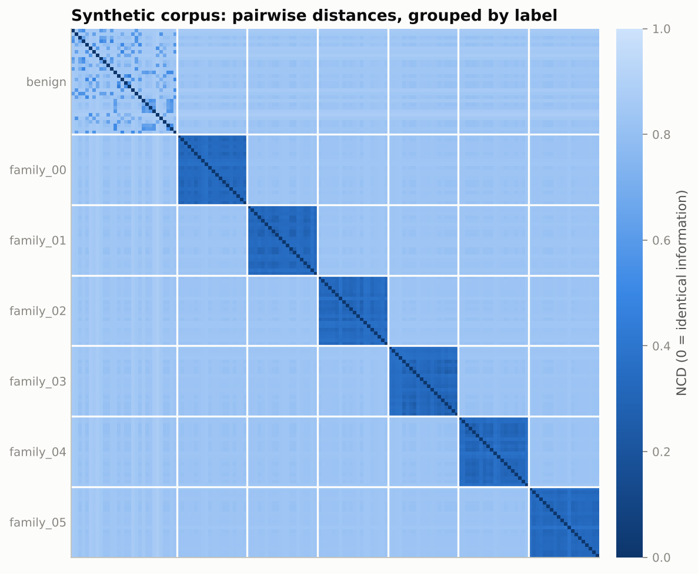
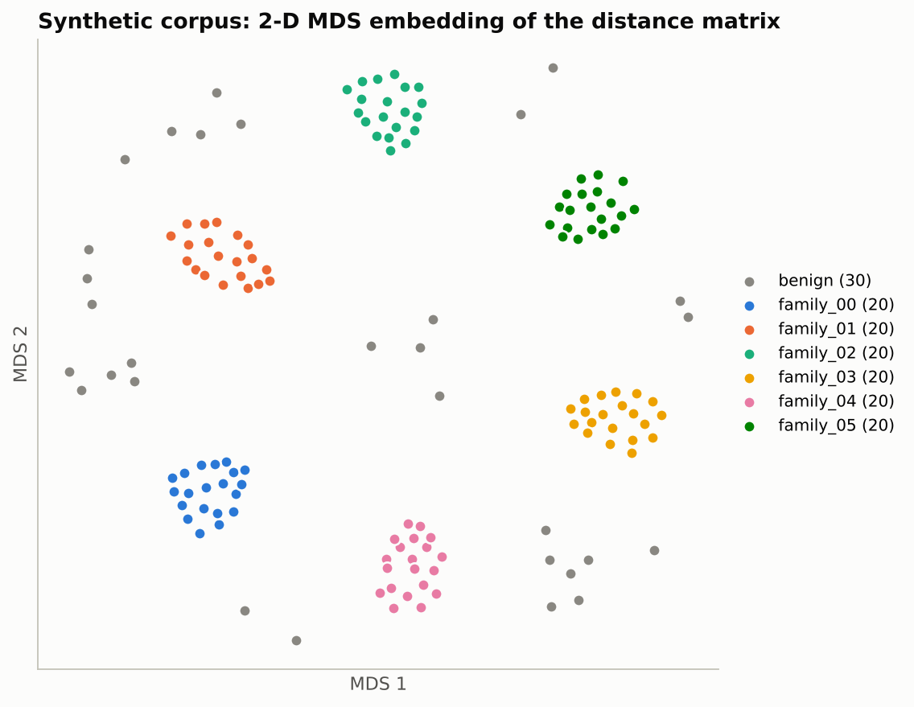

# NCD

Normalized Compression Distance (NCD) for malware family classification and network anomaly detection. The core is written in Rust and evaluated against classical machine learning baselines on the same samples.

## Background

`K(x)` is the length of the shortest program that outputs `x`. The normalized information distance

```
NID(x, y) = max{K(x|y), K(y|x)} / max{K(x), K(y)}
```

is uncomputable. Replacing `K` with a real compressor `C` gives the NCD (Cilibrasi and Vitányi, 2005):

```
NCD(x, y) = (C(xy) - min{C(x), C(y)}) / max{C(x), C(y)}
```

It needs no hand-made features or format-specific parsers. Real compressors also break the metric axioms, have finite windows and add a fixed cost per object. This project measures those effects.

## Components

- `ncd-core`: zstd, xz, bzip2 and DEFLATE codecs; parallel pairwise and cross matrices; two estimators (`concat` uses `C(xy)`, `conditional` compresses the larger object using the smaller one as a zstd dictionary); window overflow warnings; bounds-checked PE/ELF code section extraction; k-NN, anomaly scores and metrics.
- `ncd`: command line interface with `dist`, `matrix`, `eval`, `score`, `bench` and `synth`.
- `ncdthreat`: Python bindings via PyO3. Bytes are borrowed without copying and the GIL is released during compression.
- `python/`: random or temporal train/test splits, EMBER and flow baselines (GBDT, k-NN, Isolation Forest), CICFlowMeter windowing, NCD evaluation and plots.
- `flake.nix` and CI: build, tests, clippy, an end-to-end smoke test and `nix flake check`.

## Usage

```bash
nix develop            # or rustup plus python/requirements.txt
cargo build --release
cargo test --release
maturin develop --release -m crates/ncd-py/Cargo.toml
./scripts/demo.sh      # synthetic benchmark and figures
```

```bash
ncd dist a.exe b.exe -c zstd:19 -m conditional -v code
ncd eval corpus/ -k 1 --split-file splits.csv --json results/malware_ncd.json
ncd score --refs benign_train/ --queries test/ -k 5 -o scores.csv
ncd bench corpus/ --codecs zstd:3,zstd:19,xz:9,bzip2:9,deflate:9
```

```python
import ncdthreat as nt
D = nt.pairwise(objs, codec="zstd:19", method="conditional")
s = nt.anomaly_scores(queries, benign_refs, k=5)
```

A corpus is a directory `ROOT/<label>/<sample>`. The file stem, usually the SHA-256, is the sample id.

## Synthetic results

150 synthetic samples (6 families of 20 plus 30 benign, 22 KB on average), 11,175 pairs, 2 cores. Every codec reaches 1.0 leave-one-out accuracy, so the corpus only checks the pipeline. The differences are in cost and diagnostics.

| codec | estimator | NCD(x,x) | pairs over window | matrix time |
|---|---|---:|---:|---:|
| zstd:3 | concat | 0.0008 | 0 | 1.3 s |
| zstd:19 | concat | 0.0009 | 0 | 58.8 s |
| zstd:19 | conditional | 0.0019 | 0 | 17.2 s |
| xz:9 | concat | 0.0063 | 0 | 57.1 s |
| bzip2:9 | concat | 0.2697 | 0 | 32.9 s |
| deflate:9 | concat | 0.0456 | 11,175 | 11.5 s |

<p align="center">
  
  
</p>

Observations:

- `conditional` is 3.4x faster than `concat` at zstd:19 with the same accuracy, because each dictionary is built once per row.
- DEFLATE has a 32 KiB window. Above it `C(xy) ≈ C(x) + C(y)` and NCD saturates near 1, even for identical objects.
- bzip2 gives `NCD(x, x) ≈ 0.27` on incompressible data, so it fails the identity axiom.
- xz presets 7 to 9 allocated a 16 to 64 MiB dictionary per call. Limiting it to the input size gives identical output and cut an 80-sample matrix from 366 s to 11 s.
- The CLI and the Python bindings produce the same anomaly AUC to four decimals.

On generated CICFlowMeter traffic (`python/ablation_window.py`, zstd:19, k = 5), window size matters more than the estimator:

| flows/window | bytes | k-NN F1 concat | k-NN F1 conditional | AUC concat | AUC conditional |
|---:|---:|---:|---:|---:|---:|
| 16 | 176 | 0.106 | 0.705 | 0.764 | 0.776 |
| 32 | 348 | 0.921 | 0.856 | 0.839 | 0.729 |
| 64 | 699 | 1.000 | 0.797 | 0.934 | 0.925 |
| 128 | 1,399 | 1.000 | 0.732 | 0.990 | 1.000 |

The defaults are 64-flow windows with `concat` for traffic and `conditional` for binaries. Baselines on aggregate flow statistics score about 1.0 on this generated traffic, so a real comparison needs real captures.

## Real data

### Malware

NCD needs raw binaries with family labels.

- BODMAS (Yang et al., 2021): 57,293 malware and 77,142 benign PE files, 581 families, timestamps and EMBER features for the same samples.
- EMBER2024 (Joyce et al., 2025): 6,787 families, but only hashes and features are distributed.
- MalwareBazaar: individual samples with family signatures.

```bash
python python/make_split.py --meta bodmas_metadata.csv --id-col sha --label-col family \
    --time-col timestamp --protocol temporal --min-per-family 20 --max-per-family 60 \
    --samples-dir /data/bodmas/raw --link-to corpus/ --out splits.csv
ncd eval corpus/ --split-file splits.csv -k 1 -m conditional --json results/malware_ncd.json
python python/baseline_malware.py --npz bodmas.npz --index bodmas_metadata.csv \
    --split splits.csv --out-dir results/
python python/compare.py results/
```

The temporal split trains on older samples and tests on newer ones (Pendlebury et al., 2019). Samples are only read as bytes, never executed; keep them in an isolated VM and outside the repository.

### Traffic

```bash
python python/prepare_flows.py MachineLearningCSV/*.csv --out flows/ --window 64
python python/baseline_flows.py flows/ --out-dir results/
python python/eval_flows_ncd.py flows/ --codec zstd:19 --max-refs 2000 --out-dir results/
python python/compare.py results/
```

The anomaly detector is fitted on benign training windows only. CIC-IDS2017 has known feature and labeling errors (Engelen et al., 2021; Rosay et al., 2022), so LYCOS-IDS2017 is preferable. `--drop-port` removes the destination port.

## References

- M. Li, X. Chen, X. Li, B. Ma, P. Vitányi. The similarity metric. IEEE Trans. Inf. Theory 50(12), 2004.
- R. Cilibrasi, P. Vitányi. Clustering by compression. IEEE Trans. Inf. Theory 51(4), 2005.
- M. Cebrián, M. Alfonseca, A. Ortega. Common pitfalls using the normalized compression distance. Commun. Inf. Syst. 5(4), 2005.
- H. Anderson, P. Roth. EMBER: An open dataset for training static PE malware machine learning models. arXiv:1804.04637, 2018.
- L. Yang et al. BODMAS: An open dataset for learning based temporal analysis of PE malware. DLS 2021.
- R. J. Joyce et al. EMBER2024: A benchmark dataset for holistic evaluation of malware classifiers. arXiv:2506.05074, 2025.
- F. Pendlebury et al. TESSERACT: Eliminating experimental bias in malware classification across space and time. USENIX Security 2019.
- G. Engelen, V. Rimmer, W. Joosen. Troubleshooting an intrusion detection dataset: the CICIDS2017 case study. IEEE SPW 2021.
- A. Rosay, E. Cheval, F. Carlier, P. Leroux. Network intrusion detection: a comprehensive analysis of CIC-IDS2017. ICISSP 2022.
