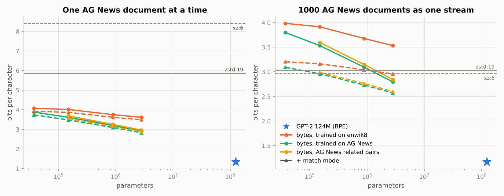
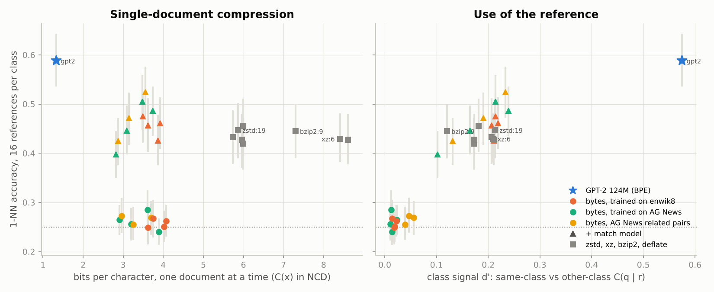
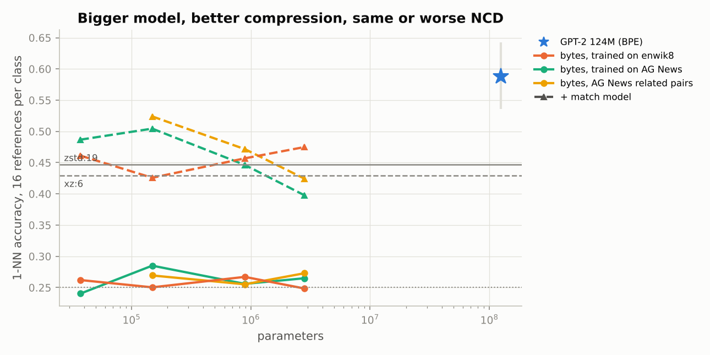

# Modelos de lenguaje como compresores para la NCD

Un modelo de lenguaje con codificación aritmética es un compresor: codifica cada símbolo con unos $-\log_2 \hat p(x_t \mid x_{<t})$ bits. Este documento mide tres cosas sobre el mismo texto:

1. Los bits por carácter de modelos de varios tamaños frente a zstd y xz.
2. Si esa tasa de compresión predice el desempeño en una tarea.
3. Qué pasa al usarlos como el compresor $C$ de la NCD.

La tarea es clasificar noticias de AG News con k-NN sobre la NCD, el mismo clasificador que el proyecto usa con binarios y tráfico.

## 1. Montaje

### Códec

`python/lmcodec` implementa:

- un codificador aritmético entero (Witten, Neal y Cleary, 1987) con 48 bits de estado y frecuencias cuantizadas a $2^{32}$, cada símbolo con frecuencia mínima 1;
- un transformer decodificador con caché de claves y valores, compartido por GPT-2 y los modelos por bytes.

Un código es la cuenta de símbolos (varint) seguida de la salida del codificador, y $C(x)$ es su longitud en bytes. Para las matrices de NCD la longitud se calcula a partir de la información $\sum_t -\log_2 \hat p$ de una pasada en lote. La codificación y decodificación reales son incrementales, una pasada por símbolo, que es lo que un decodificador puede reproducir. En todos los documentos verificados la decodificación recupera el original y la longitud real difiere de la estimada en 1 byte como mucho.

Con longitudes ideales, $C(xy) = C(x) + C(y \mid x)$. El estimador `concat` pone la referencia primero, $C(r\,q)$, para que la caché de cada referencia sirva a todas las consultas; ncd-core pone primero la consulta. `conditional` usa como prefijo el objeto más simple, y entonces coincide con `concat` (lo comprueba `test_lmcodec.py`). El contexto del modelo cumple el papel de la ventana LZ: si prefijo y objetivo no caben, el prefijo se recorta por la izquierda y se avisa.

`python/ncd_backend.py` expone `cross`, `pairwise` y `anomaly_scores` con la firma de `ncdthreat`. Un códec `lm:RUTA.pt` usa un modelo y cualquier otro va a Rust, así que `eval_flows_ncd.py --codec lm:modelo.pt` ya funciona sobre ventanas de flujos.

### Modelos

Desde este entorno solo se pudo descargar un modelo preentrenado: GPT-2 de 124M (Radford et al., 2019), del ONNX Model Zoo. `convert_gpt2_onnx.py` lo pasa a PyTorch y lo compara con onnxruntime (diferencia máxima en logits de $3 \times 10^{-4}$). Para tener varios tamaños con los mismos datos se entrenaron en CPU transformers por bytes con 8 MB de texto cada uno, en el mismo orden:

| familia | datos de entrenamiento |
|---|---|
| `enwik8` | primeros 90 MB de enwik8, texto general de Wikipedia con marcado |
| `agnews` | noticias del split de entrenamiento de AG News, en orden aleatorio, sin las referencias ni copias de documentos de evaluación |
| `agpair` | igual que `agnews`, pero cada noticia va seguida de su vecina más parecida por TF-IDF (sin usar etiquetas) |

Los tamaños son 37K, 149K, 892K y 2.8M parámetros (1 a 6 capas, ancho de 32 a 192, contexto de 512 bytes); `agpair` tiene los tres mayores. `agpair` es una intervención: en noticias consecutivas al azar el modelo no gana nada mirando el documento anterior, y en `agpair` sí.

### Modelo de coincidencias

`lmcodec/match.py` es el modelo de coincidencias de PAQ y lpaq (Mahoney, 2005). Busca la última aparición de los 4 bytes anteriores, predice el byte que la siguió y alarga la coincidencia mientras acierte. Se mezcla con la red así:

$$p(a) = (1 - w_L)\,p_{\mathrm{red}}(a) + w_L\,[a = \hat a]$$

El peso $w_L$ depende solo de la longitud $L$ de la coincidencia y se ajusta por máxima verosimilitud con 300 pares de noticias de validación (relacionadas y al azar). Es la otra intervención: le da al modelo una forma explícita de reutilizar el contexto, sin cambiar la red. Las variantes llevan el sufijo `+ match`.

### Tarea y medidas

- AG News (Zhang et al., 2015), 4 clases. Un documento es `título. descripción` cortado a 255 bytes con salto de línea final, de modo que dos documentos y el símbolo inicial caben en 512 bytes. Todos los compresores ven los mismos bytes.
- 16 referencias por clase del split de entrenamiento y 300 consultas balanceadas del de prueba. Clasificador 1-NN sobre la NCD. Como las longitudes son bytes enteros y los textos cortos, varias referencias empatan a menudo en la distancia mínima, en hasta el 79 % de las consultas con los modelos por bytes. Tomar la primera favorecería a la clase listada primero, así que la exactitud es la esperada con desempate al azar: un empate entre k referencias cuenta 1/k por cada una correcta. El intervalo del 95 % es bootstrap sobre consultas. Las curvas de 1 a 8 referencias por clase promedian 200 subconjuntos.
- Bits por carácter (bits por byte UTF-8; el texto es casi todo ASCII) en tres conjuntos que no participan en la tarea:
  - `doc`: 1000 noticias de prueba comprimidas una a una, que es lo que la NCD usa como $C(x)$;
  - `flujo`: las mismas 1000 noticias concatenadas (220 KB);
  - `enwik8`: 100 KB del split de prueba de enwik8.
  Los modelos codifican los flujos con ventana deslizante de medio contexto.
- Diagnósticos de la distancia:
  - $\mathrm{NCD}(x, x)$;
  - la **señal de clase**: cuántos bits por carácter ahorra una referencia de la clase correcta frente a una de otra clase al codificar la consulta después de ella;
  - su versión estandarizada $d'$, la diferencia dividida por la dispersión de $C(q \mid r)$ entre referencias;
  - el AUC con que la distancia separa pares de la misma clase.

## 2. Resultados

### 2.1 Bits por carácter

| compresor | parámetros | documento suelto | flujo AG News | enwik8 |
|---|---:|---:|---:|---:|
| zstd:1 | | 5.97 | 3.54 | 3.28 |
| zstd:19 | | 5.86 | 3.03 | 2.81 |
| xz:6 | | 8.41 | 2.97 | 2.71 |
| bzip2:9 | | 7.30 | 2.79 | 2.66 |
| bytes `enwik8` | 37K → 2.8M | 4.07 → 3.62 | 3.98 → 3.53 | 3.71 → 2.99 |
| bytes `agnews` | 37K → 2.8M | 3.89 → 2.91 | 3.80 → 2.80 | 5.69 → 5.18 |
| bytes `enwik8` + match | 2.8M | 3.49 | 2.96 | 2.38 |
| bytes `agnews` + match | 2.8M | 2.82 | 2.57 | 3.52 |
| GPT-2 | 124M | **1.33** | **1.17** | **1.19** |

<p align="center"></p>

- **Documento suelto.** Todos los modelos comprimen una noticia mejor que zstd o xz. Con 220 bytes de media domina el coste fijo de §4 de FUNDAMENTOS: el contenedor xz cuesta unos 50 bytes incluso con un solo byte de entrada, y la noticia sale con más de 8 bits por carácter. Un compresor sin conocimiento previo tampoco tiene nada que reutilizar dentro de un texto tan corto.
- **Flujo.** zstd y xz recuperan terreno porque ven todo el historial. Los modelos por bytes, con 8 MB de entrenamiento y 512 bytes de contexto, solo superan a xz con 2.8M parámetros entrenados en noticias. El modelo de coincidencias aporta la repetición lejana: con él el modelo `agnews` de 2.8M baja a 2.57 y el `enwik8` de 2.8M queda por debajo de xz en enwik8 (2.38 frente a 2.71). En el flujo de noticias GPT-2 comprime 2.5 veces mejor que xz; su 1.19 en enwik8 está cerca del 1.16 publicado para el GPT-2 más pequeño.
- **Tamaño.** Dentro de cada familia, la tasa en su propio dominio mejora de forma monótona con el tamaño. Los modelos de noticias son mucho mejores en noticias y mucho peores en enwik8.
- **Codificación aritmética real.** En las 23 configuraciones con modelo, la decodificación de cuatro documentos de prueba recuperó el original. La longitud real difirió de la estimada en 0 o 1 byte.

### 2.2 Desempeño en la tarea

1-NN con 16 referencias por clase y 300 consultas. El azar da 0.25.

| compresor | exactitud [IC 95 %] | $\mathrm{NCD}(x,x)$ | señal de clase (bits/car.) | $d'$ |
|---|---:|---:|---:|---:|
| GPT-2 124M | **0.588** [0.536, 0.643] | 0.11 | 0.032 | **0.575** |
| zstd:19 | 0.447 [0.389, 0.503] | 0.03 | 0.026 | 0.213 |
| xz:6 | 0.430 [0.382, 0.481] | 0.01 | 0.038 | 0.209 |
| bzip2:9 | 0.445 [0.390, 0.500] | 0.17 | 0.033 | 0.120 |
| zstd:1, zstd:3, zstd:9, xz:1, deflate:9 | 0.419 a 0.455 | 0.01 a 0.04 | 0.022 a 0.041 | 0.17 a 0.21 |
| 11 modelos por bytes, solos | 0.240 a 0.285 | 0.96 a 0.98 | ≤ 0.001 | ≤ 0.06 |
| los mismos 11 + match | 0.398 a 0.524 | 0.04 a 0.06 | 0.003 a 0.014 | 0.10 a 0.24 |
| referencia: TF-IDF de palabras, 1-NN coseno | 0.573 | | | |
| referencia: TF-IDF de caracteres, regresión logística | 0.637 | | | |

<p align="center"></p>

Comparaciones pareadas sobre las mismas 300 consultas. La p sale de 20 000 permutaciones de signo, así que < 10⁻⁴ es su resolución:

| A | B | exactitud A − B [IC 95 %] | p (permutación pareada) |
|---|---|---:|---:|
| GPT-2 | zstd:19 | +0.141 [+0.078, +0.209] | < 10⁻⁴ |
| `enwik8` 2.8M + match | `enwik8` 2.8M | +0.226 [+0.160, +0.291] | < 10⁻⁴ |
| `agnews` 149K + match | `agnews` 2.8M + match | +0.107 [+0.050, +0.158] | 2 × 10⁻⁴ |
| `agpair` 149K + match | `agpair` 2.8M + match | +0.100 [+0.050, +0.154] | 2.5 × 10⁻⁴ |
| `agpair` 149K + match | zstd:19 | +0.077 [+0.016, +0.140] | 0.016 |
| zstd:19 | zstd:1 | +0.020 [−0.029, +0.067] | 0.42 |

La quinta fila elige el mejor modelo pequeño después de ver los resultados, así que es exploratoria.

<p align="center"></p>

### 2.3 ¿Predice la tasa de compresión el desempeño?

Correlación de Spearman entre exactitud y cada medida. Un ρ negativo con los bits por carácter significa que comprimir mejor va con más exactitud. El intervalo remuestrea consultas.

| compresores | n | bits/car., documento | bits/car., flujo | $d'$ |
|---|---:|---:|---:|---:|
| todos | 31 | −0.02 [−0.15, +0.16] | −0.53 [−0.64, −0.38] | **+0.89** [+0.79, +0.92] |
| los que usan el contexto (clásicos, GPT-2, + match) | 20 | −0.31 [−0.60, +0.05] | −0.24 [−0.56, +0.09] | **+0.73** [+0.33, +0.82] |
| modelos + match | 11 | +0.37 [−0.17, +0.63] | +0.39 [−0.15, +0.65] | **+0.83** [+0.35, +0.92] |
| clásicos | 8 | −0.24 [−0.69, +0.74] | −0.57 [−0.86, +0.39] | +0.14 [−0.52, +0.71] |

La respuesta es no. Con los bits por carácter del flujo hay solo una relación gruesa (ρ = −0.53 entre los 31), que sale sobre todo de separar a los modelos que no usan el contexto, malos en el flujo y al azar en la tarea, del resto:

1. **Comprimir bien un documento suelto no predice nada** (ρ = −0.02). Los 11 modelos por bytes comprimen cada noticia entre 1.4 y 2 veces mejor que zstd:19 (hasta 2.9 veces mejor que xz) y aun así se quedan entre 0.24 y 0.29, casi al azar. Su $\mathrm{NCD}(x,x) \approx 0.97$ dice por qué: no usan el contexto. Para ellos $C(xy) \approx C(x) + C(y)$, el mismo fallo que un LZ con la ventana demasiado pequeña (§4 de FUNDAMENTOS). Con 8 MB de texto no llegaron a aprender a copiar, la capacidad que en transformers aparece con las cabezas de inducción (Olsson et al., 2022). Juntar en el entrenamiento cada noticia con una parecida (`agpair`) tampoco bastó.
2. **Lo que predice es cuánto ayuda la referencia correcta**, la señal $d'$ (ρ = 0.89). La intervención lo muestra directamente. Añadir el modelo de coincidencias apenas cambia los bits por carácter de un documento (entre 0.09 y 0.15). En cambio lleva la exactitud del azar al nivel de zstd y xz: +0.23 en el modelo `enwik8` de 2.8M.
3. **Entre los compresores que sí usan el contexto, comprimir mejor apenas ayuda, y dentro de una familia puede empeorar.** En ese grupo, ρ es −0.31 con el documento suelto y −0.24 con el flujo, y ambos intervalos cruzan el 0. En las familias de noticias con match, el modelo más grande comprime mejor y clasifica peor (0.50 frente a 0.40 en `agnews`, 0.52 frente a 0.42 en `agpair`). Cuanto más predice el modelo una noticia desde su conocimiento previo, menos le queda por aportar a la referencia: la señal de clase cae de 0.013 a 0.003 bits por carácter. Un modelo que solo conoce el dominio absorbe el vocabulario compartido que la NCD necesita ver.
4. **GPT-2 es el único bueno en ambas cosas en esta corrida** (Pythia, en §2.4, también lo es). En el flujo de noticias comprime 2.5 veces mejor que xz, y es el único modelo de esta corrida que se adapta al contexto: $\mathrm{NCD}(x,x) = 0.11$. Su señal de clase en bits por carácter es parecida a la de zstd, pero mucho menos ruidosa ($d'$ de 0.575 frente a 0.21). En los LZ, $C(q \mid r)$ salta con repeticiones incidentales; en GPT-2 varía con el tema.

Huang et al. (2024) encuentran una correlación cercana a −0.95 entre los bits por carácter y el promedio de benchmarks en unos 30 LLM. Esos modelos aprenden todos en contexto. En la NCD la cantidad que importa es $C(y \mid x)$, la compresión condicional, y los bits por carácter de un texto suelto no la miden. GPT-2 frente a zstd encaja con la idea de que un mejor compresor da una mejor NCD, pero eso no se debe a la tasa de compresión en sí.

En la práctica, la NCD con GPT-2 queda a la par del 1-NN sobre TF-IDF (0.588 frente a 0.573) y por debajo de una regresión logística (0.61 a 0.64). La matriz de 300 × 64 tardó 22 minutos en un núcleo con bf16; con zstd:19 tardó 1 segundo.

### 2.4 Familia Pythia (ejecutada después, en una Titan X)

Pythia (Biderman et al., 2023) es una familia de modelos entrenados con los mismos datos y en el mismo orden, en varios tamaños. Es la prueba que faltaba: modelos que sí aprenden en contexto y solo difieren en tamaño. Se usó el adaptador `hf:` en float32, con la misma tarea y las mismas medidas.

| modelo | bits/car., documento | bits/car., flujo | $\mathrm{NCD}(x,x)$ | $d'$ | exactitud [IC 95 %] |
|---|---:|---:|---:|---:|---:|
| pythia-70m | 1.59 | 1.43 | 0.12 | **0.757** | **0.657** [0.607, 0.707] |
| pythia-160m | 1.41 | 1.21 | 0.11 | 0.616 | 0.623 [0.570, 0.673] |
| pythia-410m | 1.24 | 1.03 | 0.10 | 0.597 | 0.594 [0.544, 0.646] |
| pythia-1b | 1.18 | 0.97 | 0.08 | 0.583 | 0.602 [0.549, 0.657] |

Los cuatro usan el contexto ($\mathrm{NCD}(x,x) \le 0.12$). Del más pequeño al más grande, los bits por carácter bajan sin excepción y la exactitud no sube: el más pequeño es el mejor. $d'$ sigue a la exactitud (Pearson 0.94). Es el mismo patrón que en las familias de noticias con modelo de coincidencias: cuanto más predice el modelo desde su conocimiento previo, menos aporta la referencia.

Con 4 tamaños, la correlación dentro de la familia no es significativa (Spearman 0.8, p = 0.2), y falta la prueba pareada entre tamaños. Sobre los 35 compresores, $d'$ predice la exactitud con ρ = 0.93; los bits por carácter de un documento suelto, con −0.31. pythia-70m (0.657) supera a GPT-2 (0.588) y queda a la par de la regresión logística sobre TF-IDF (0.637).

## 3. Limitaciones

- **Pocos tamaños preentrenados.** Las primeras corridas solo tenían GPT-2 de 124M. Pythia (§2.4) añade cuatro tamaños de una misma familia, pero cuatro puntos no bastan para una correlación significativa.
- **Modelos por bytes pequeños y poco entrenados** (8 MB en CPU). Sus conclusiones valen para ese régimen, en el que no saben copiar.
- **Una sola partición de 300 consultas.** Un intervalo es de unos ±5 puntos y las comparaciones elegidas después de ver los datos son exploratorias.
- **Montaje del texto y de la NCD.**
  - Los documentos se cortan a 255 bytes.
  - `concat` pone la referencia primero.
  - Los pesos del modelo de coincidencias se ajustan con 300 pares de noticias de validación, sin documentos de la tarea.
- **Unidades.** "Por carácter" es por byte UTF-8; AG News es casi todo ASCII.

## 4. Reproducción

`scripts/download_text_data.sh` y `scripts/text_experiment.sh` hacen todo lo de abajo y se reanudan donde quedaron. Las opciones, como GPU, modelos mayores o familias de HuggingFace, están en [PASOS.md](PASOS.md). Paso a paso:

```bash
pip install -r python/requirements.txt -r python/requirements-lm.txt
maturin develop --release -m crates/ncd-py/Cargo.toml
python python/test_lmcodec.py

# datos: AG News (train.csv, test.csv), enwik8.gz, GPT-2 del ONNX Model Zoo y encoder.json/vocab.bpe
python python/prep_text_task.py --ag-dir data/ag --enwik8 data/enwik8.gz --out data/text_task
python python/convert_gpt2_onnx.py data/gpt2-lm-head-10.onnx --tokenizer-dir data/tok --out models/gpt2-124m.pt
python python/train_byte_lm.py --data data/enwik8.gz --out models/enwik8/b2.8m.pt \
    --n-layer 6 --n-embd 192 --n-head 6 --lr 1.5e-3 --train-bytes 8e6
python python/train_byte_lm.py --corpus lines --data data/text_task/lm_train.txt \
    --valid data/text_task/lm_valid.txt --out models/agnews/b2.8m.pt --n-layer 6 --n-embd 192 --n-head 6 --lr 1.5e-3
python python/make_paired_corpus.py data/text_task/lm_train.txt --out data/text_task/lm_train_paired.txt

python python/run_text_experiment.py --task-dir data/text_task --out results/text --tokenizer-dir data/tok \
    zstd:1 zstd:3 zstd:9 zstd:19 xz:1 xz:6 bzip2:9 deflate:9 \
    lm:gpt2-124m=models/gpt2-124m.pt lm:agnews-b2.8m=models/agnews/b2.8m.pt \
    "lm+match:agnews-b2.8m+match=models/agnews/b2.8m.pt"
python python/baseline_text.py --task-dir data/text_task --out results/analysis
python python/analyze_text.py --task-dir data/text_task --results results/text --out results/analysis
python python/plot_text.py results/analysis/text_summary.json --out-dir docs/img
```

Los tamaños usados son `--n-layer/--n-embd/--n-head` 1/32/2, 2/64/4, 4/128/4 y 6/192/6, con `--lr` 3e-3, 3e-3, 2e-3 y 1.5e-3. En 2 núcleos, el entrenamiento de las 11 redes y todas las evaluaciones tardaron unas dos horas.

Para usar un modelo en los demás scripts:

```bash
python python/eval_flows_ncd.py flows/ --codec lm:models/flows/b2.8m.pt --max-refs 500
```

## 5. Pasos siguientes

Los comandos de cada uno están en [PASOS.md](PASOS.md) (§2.2, §2.3 y §4.3).

1. **Una familia preentrenada de varios tamaños.** Con acceso a HuggingFace, repetir con Pythia (70M a 1.4B, mismos datos) o GPT-2 S/M/L/XL. Es la prueba que falta: si entre modelos que aprenden en contexto los bits por carácter predicen la exactitud, como en Huang et al. (2024), o si también ahí manda $d'$.
2. **Llevarlo a los dominios del proyecto.** Entrenar modelos por bytes con ventanas de flujos benignos (lunes de CIC-IDS2017) y con secciones de código de PE benignos. Hay que entrenarlos el tiempo suficiente para que aprendan a copiar, o mezclarlos con el modelo de coincidencias, y compararlos con zstd con `eval_flows_ncd.py --codec lm:...`.
3. **Sorpresa como puntuación de anomalía.** Un modelo entrenado solo con tráfico benigno da directamente $-\log_2 \hat p(q)$ por consulta, sin referencias y con coste lineal en vez de cuadrático. Conviene compararla con la NCD k-NN del protocolo A.
4. **Un códec de mezcla de contextos nativo** en ncd-core (modelo de coincidencias más contextos de orden k, como lpaq). Daría el efecto de `+ match` sin PyTorch y con la velocidad de Rust.

## Referencias

- G. Delétang et al. Language modeling is compression. ICLR 2024.
- Y. Huang, J. Zhang, Z. Shan, J. He. Compression represents intelligence linearly. COLM 2024.
- Z. Jiang et al. "Low-resource" text classification: a parameter-free classification method with compressors. Findings of ACL 2023.
- C. Olsson et al. In-context learning and induction heads. Transformer Circuits Thread, 2022.
- A. Radford et al. Language models are unsupervised multitask learners. OpenAI, 2019.
- S. Biderman et al. Pythia: a suite for analyzing large language models across training and scaling. ICML 2023.
- M. Mahoney. Adaptive weighing of context models for lossless data compression. Florida Tech. TR CS-2005-16, 2005 (modelo de coincidencias de PAQ/lpaq).
- I. H. Witten, R. M. Neal, J. G. Cleary. Arithmetic coding for data compression. Commun. ACM 30(6), 1987.
- X. Zhang, J. Zhao, Y. LeCun. Character-level convolutional networks for text classification. NeurIPS 2015.

## Apéndice: tabla completa

`ties` es la fracción de consultas con empate en la distancia mínima. Las columnas de 1 y 4 referencias por clase promedian los mismos 200 subconjuntos para todos los compresores.

| compressor | params | bpc doc | bpc stream | bpc enwik8 | NCD(x,x) | class signal | class d' | same-class AUC | ties | 1-NN acc [95% CI] | macro-F1 | 1-shot | 4-shot |
|---|---:|---:|---:|---:|---:|---:|---:|---:|---:|---:|---:|---:|---:|
| gpt2-124m | 124.4M | 1.328 | 1.167 | 1.194 | 0.112 | 0.032 | 0.575 | 0.628 | 0.16 | 0.588 [0.536, 0.643] | 0.577 | 0.416 | 0.491 |
| agnews-b037k | 37K | 3.885 | 3.799 | 5.686 | 0.979 | 0.000 | 0.014 | 0.500 | 0.79 | 0.240 [0.214, 0.268] | 0.222 | 0.252 | 0.250 |
| agnews-b149k | 149K | 3.612 | 3.533 | 5.405 | 0.977 | 0.000 | 0.012 | 0.500 | 0.60 | 0.285 [0.248, 0.325] | 0.304 | 0.249 | 0.262 |
| agnews-b892k | 892K | 3.197 | 3.094 | 5.323 | 0.967 | 0.000 | 0.010 | 0.502 | 0.70 | 0.256 [0.223, 0.290] | 0.289 | 0.253 | 0.254 |
| agnews-b2.8m | 2.8M | 2.910 | 2.796 | 5.180 | 0.958 | 0.000 | 0.023 | 0.503 | 0.72 | 0.265 [0.234, 0.295] | 0.263 | 0.259 | 0.259 |
| agnews-b037k+match | 37K | 3.740 | 3.092 | 3.853 | 0.044 | 0.013 | 0.239 | 0.546 | 0.17 | 0.487 [0.435, 0.535] | 0.479 | 0.322 | 0.396 |
| agnews-b149k+match | 149K | 3.482 | 2.960 | 3.626 | 0.049 | 0.010 | 0.214 | 0.537 | 0.18 | 0.504 [0.448, 0.560] | 0.492 | 0.308 | 0.379 |
| agnews-b892k+match | 892K | 3.091 | 2.732 | 3.574 | 0.053 | 0.006 | 0.164 | 0.526 | 0.33 | 0.446 [0.398, 0.497] | 0.460 | 0.298 | 0.357 |
| agnews-b2.8m+match | 2.8M | 2.824 | 2.571 | 3.522 | 0.062 | 0.003 | 0.102 | 0.515 | 0.43 | 0.398 [0.349, 0.445] | 0.409 | 0.277 | 0.322 |
| agpair-b149k | 149K | 3.690 | 3.597 | 5.294 | 0.974 | 0.001 | 0.056 | 0.506 | 0.64 | 0.269 [0.234, 0.303] | 0.301 | 0.258 | 0.266 |
| agpair-b892k | 892K | 3.253 | 3.149 | 5.225 | 0.963 | 0.001 | 0.039 | 0.506 | 0.66 | 0.255 [0.223, 0.291] | 0.245 | 0.258 | 0.252 |
| agpair-b2.8m | 2.8M | 2.961 | 2.845 | 5.301 | 0.957 | 0.001 | 0.047 | 0.507 | 0.67 | 0.273 [0.238, 0.310] | 0.283 | 0.259 | 0.260 |
| agpair-b149k+match | 149K | 3.556 | 2.987 | 3.556 | 0.048 | 0.011 | 0.233 | 0.540 | 0.20 | 0.524 [0.472, 0.576] | 0.519 | 0.319 | 0.411 |
| agpair-b892k+match | 892K | 3.145 | 2.765 | 3.539 | 0.057 | 0.007 | 0.191 | 0.533 | 0.30 | 0.472 [0.417, 0.523] | 0.482 | 0.302 | 0.359 |
| agpair-b2.8m+match | 2.8M | 2.872 | 2.601 | 3.574 | 0.063 | 0.004 | 0.131 | 0.519 | 0.39 | 0.424 [0.375, 0.471] | 0.426 | 0.283 | 0.336 |
| bzip2:9 |  | 7.295 | 2.789 | 2.659 | 0.173 | 0.033 | 0.120 | 0.527 | 0.05 | 0.445 [0.390, 0.500] | 0.437 | 0.282 | 0.338 |
| deflate:9 |  | 5.736 | 3.312 | 2.980 | 0.038 | 0.029 | 0.206 | 0.545 | 0.11 | 0.432 [0.379, 0.487] | 0.432 | 0.303 | 0.343 |
| enwik8-b037k | 37K | 4.074 | 3.984 | 3.714 | 0.975 | 0.000 | 0.023 | 0.501 | 0.69 | 0.262 [0.230, 0.295] | 0.290 | 0.249 | 0.255 |
| enwik8-b149k | 149K | 4.014 | 3.914 | 3.481 | 0.970 | 0.001 | 0.019 | 0.502 | 0.71 | 0.250 [0.219, 0.284] | 0.250 | 0.252 | 0.251 |
| enwik8-b892k | 892K | 3.752 | 3.678 | 3.144 | 0.981 | 0.000 | 0.014 | 0.502 | 0.54 | 0.267 [0.229, 0.306] | 0.255 | 0.253 | 0.254 |
| enwik8-b2.8m | 2.8M | 3.615 | 3.533 | 2.986 | 0.978 | 0.000 | 0.018 | 0.503 | 0.61 | 0.249 [0.215, 0.285] | 0.260 | 0.254 | 0.260 |
| enwik8-b037k+match | 37K | 3.923 | 3.206 | 2.759 | 0.046 | 0.014 | 0.219 | 0.544 | 0.18 | 0.461 [0.409, 0.513] | 0.456 | 0.318 | 0.379 |
| enwik8-b149k+match | 149K | 3.867 | 3.163 | 2.643 | 0.048 | 0.013 | 0.211 | 0.550 | 0.15 | 0.426 [0.376, 0.478] | 0.422 | 0.321 | 0.381 |
| enwik8-b892k+match | 892K | 3.618 | 3.040 | 2.471 | 0.053 | 0.013 | 0.206 | 0.545 | 0.13 | 0.457 [0.403, 0.512] | 0.461 | 0.316 | 0.366 |
| enwik8-b2.8m+match | 2.8M | 3.488 | 2.958 | 2.384 | 0.056 | 0.012 | 0.214 | 0.541 | 0.18 | 0.475 [0.422, 0.526] | 0.470 | 0.313 | 0.373 |
| xz:1 |  | 8.610 | 3.232 | 2.905 | 0.011 | 0.041 | 0.211 | 0.539 | 0.31 | 0.427 [0.378, 0.479] | 0.426 | 0.301 | 0.347 |
| xz:6 |  | 8.412 | 2.972 | 2.714 | 0.013 | 0.038 | 0.209 | 0.535 | 0.37 | 0.430 [0.382, 0.481] | 0.427 | 0.298 | 0.347 |
| zstd:1 |  | 5.966 | 3.535 | 3.275 | 0.031 | 0.022 | 0.173 | 0.535 | 0.14 | 0.427 [0.371, 0.480] | 0.433 | 0.297 | 0.338 |
| zstd:19 |  | 5.862 | 3.029 | 2.812 | 0.028 | 0.026 | 0.213 | 0.542 | 0.13 | 0.447 [0.389, 0.503] | 0.450 | 0.303 | 0.352 |
| zstd:3 |  | 5.991 | 3.418 | 3.095 | 0.028 | 0.022 | 0.172 | 0.532 | 0.18 | 0.419 [0.367, 0.473] | 0.408 | 0.298 | 0.350 |
| zstd:9 |  | 5.993 | 3.148 | 2.919 | 0.022 | 0.026 | 0.182 | 0.534 | 0.14 | 0.455 [0.403, 0.511] | 0.459 | 0.298 | 0.352 |
